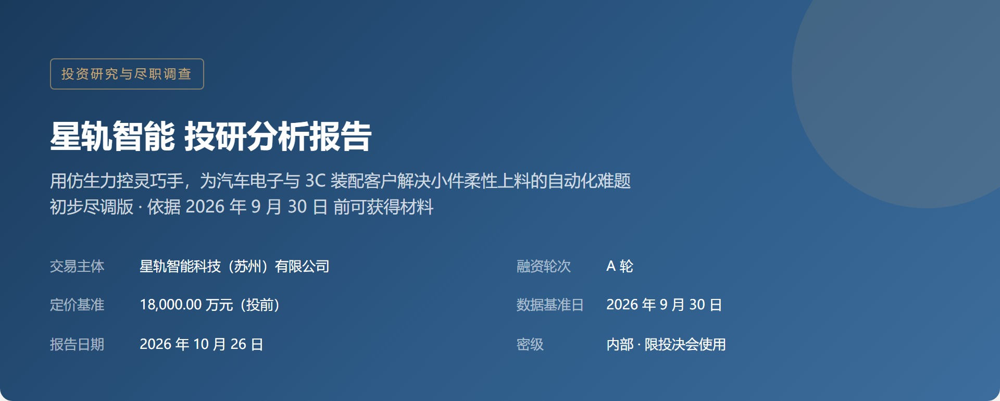
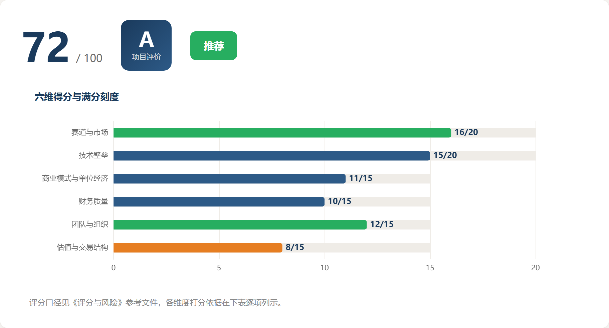
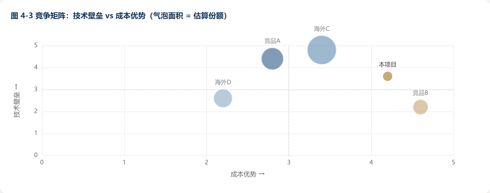
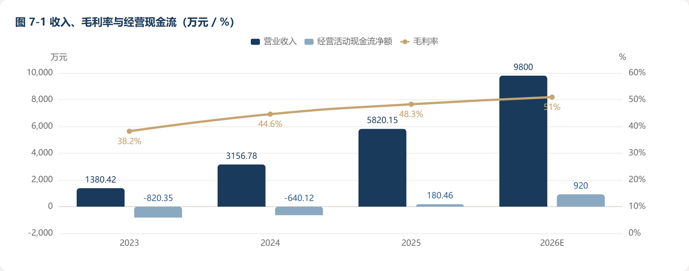
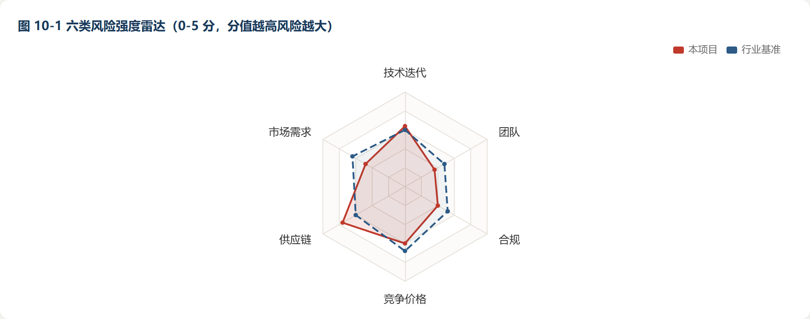
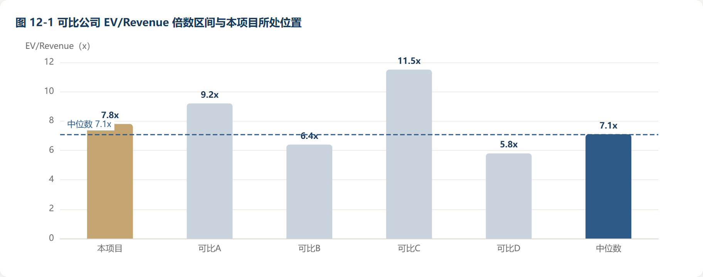
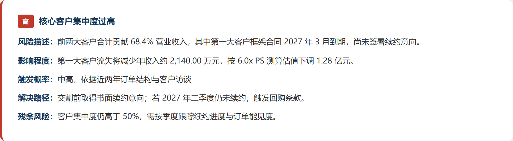
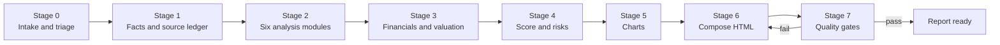

# VC-PreDD

**VC 360° due diligence report generator. Turn a pitch deck into an investment-committee-ready report: one self-contained HTML file, ten charts, a 100-point scorecard, and an explicit record of what you could not verify.**

[](#license)
[](#gallery)
[](#what-the-report-contains)
[](#quality-gates)
[](README.zh-CN.md)

**English** | [简体中文](README.zh-CN.md)



---

## Why this exists

Most AI-generated investment reports fail in the same three ways: numbers appear without a source, risks are described but never quantified or resolved, and every project comes out looking investable because the scoring scale is invented on the spot.

This skill is an opinionated answer to that. It is not a prompt you paste once. It is a working procedure with fixed scoring anchors, an evidence ledger, two automated quality gates, and a print-ready HTML template that has already been debugged against real browser and PDF rendering behaviour.

It targets early-stage financial VC (pre-seed to A+), with defaults tuned for hard tech, AI, robotics, semiconductors and enterprise software.

---

## What the report contains

Seventeen sections, in the order an investment committee actually reads them:

| # | Section | What it delivers |
|---|---|---|
| Cover | Deal identity | Target, round, pre-money, as-of date, confidentiality |
| 1 | Executive summary | Under 500 words. Judgement and logic only, no financial detail |
| 2 | Investment scorecard | Total score, six dimensions, grade, recommendation |
| 3 | Company overview | Cap table, core financials, development timeline |
| 4 | Market and value chain | TAM/SAM/SOM cross-checked three ways, drivers, competitive matrix |
| 5 | Technology and product | Route comparison, patent wall, lab-to-volume milestones |
| 6 | Business model | Unit economics, customer concentration, channel effectiveness |
| 7 | Financial diagnosis | Five reconciliation checks, revenue quality, burn rate, sensitivity |
| 8 | Team and organisation | Credential cross-verification, cap table health, org efficiency |
| 9 | Differentiation | Three claims, each with verifiable evidence |
| 10 | Risk radar and register | Radar chart plus high/medium/low risks, each with a resolution path |
| 11 | Bear case | The three strongest counter-arguments, and what would disprove them |
| 12 | Valuation and deal structure | Multi-method range, term sheet positions, exit modelling |
| 13 | Post-investment monitoring | Financial, operating, technical, market and valuation triggers |
| 14 | DD question list | Grouped by interview target, each with purpose and red-flag signal |
| 15 | Information gaps | Numbered register with impact level and acquisition route |
| 16 | Items requiring human review | Escalated, because a model should not be the final word |
| 17 | Disclaimer | Fixed wording |

---

## Gallery

Screenshots use a fictional demo company (StarRail Robotics, a dexterous-hand startup) purely to show layout. No real company data appears in this repository.

| Scorecard | Competitive matrix |
|---|---|
|  |  |

| Revenue, gross margin and operating cash flow | Risk radar |
|---|---|
|  |  |

| Valuation multiples | Risk card with resolution path |
|---|---|
|  |  |

---

## How it works



Two design decisions matter more than the rest.

**Stage 0 is blocking.** If the material cannot support a report, the skill stops and returns a materials request list instead of inventing content. A report written on missing financials is worse than no report.

**Stage 7 is a script, not an instruction.** Self-discipline does not survive a long generation. `check_report.py` mechanically verifies that every claim carries a source tag, that shareholding adds up to 100.00%, that every chart has a matching initialiser, and that banned filler phrases are absent.

---

## Install

The skill follows the `SKILL.md` folder convention. Clone it into your agent's skills directory:

```bash
git clone https://github.com/one5ds/VC-PreDD.git \
  ~/.workbuddy/skills/vc-dd-360-report
```

On Windows (PowerShell):

```powershell
git clone https://github.com/one5ds/VC-PreDD.git `
  "$env:USERPROFILE\.workbuddy\skills\vc-dd-360-report"
```

Alternatively download the release archive and unzip so that `SKILL.md` sits directly inside the skill folder.

The clone target directory is `vc-dd-360-report`, which is the skill identifier carried in the frontmatter. Keep it lowercase hyphen-case: the repository name `VC-PreDD` is a display name, the identifier is what platforms index on.

If your runtime loads `SKILL.md` skills from a different directory, place the folder there. The frontmatter carries `name`, `description`, `display_name`, `display_name_en` and `description_zh` so both Chinese and English platforms can index it.

**Requirements:** Python 3.9+ for the self-check script. Node.js 18+ with `puppeteer-core` only if you want the render check and PDF export. A locally installed Chrome or Edge works as the browser driver.

---

## Usage

Attach your material and ask in plain language. The skill triggers on intent, not on a magic command:

```
Here is the BP and the 2025 financials. Produce a 360 DD report for our IC.
```

```
帮我把这三份材料做成投决会用尽调报告，我们投 A 轮，单笔 3000 万
```

Before writing, it will confirm six strategy parameters: stage, cheque size, target ownership, sector scope, risk appetite, and return requirement. If you do not supply them, documented defaults are used and flagged on the cover page as assumptions.

Output is a single `.html` file with no external dependencies except the ECharts CDN. Open it in a browser, or print to A4 and it paginates correctly.

---

## Scoring model

A score is only useful if the same scale applies to every project. Six fixed dimensions, 100 points total:

| Dimension | Weight | Full-mark anchor |
|---|---|---|
| Market and sector | 20 | TAM above CNY 50bn, CAGR above 20%, policy support, penetration in the 5%-25% acceleration band |
| Technical moat | 20 | Key metric 30%+ better than incumbent, patents freely operable, engineering validated, no mature substitute within two years |
| Business model and unit economics | 15 | LTV/CAC at least 3, gross margin at least 50%, cash cycle under 90 days, repeat purchase proven |
| Financial quality | 15 | Revenue matched by cash, no abnormal receivables, reconciliations self-consistent, runway at least 18 months |
| Team and organisation | 15 | Founder background verified, control stable, key-person risk mitigated, sales productivity above peer median |
| Valuation and deal terms | 15 | Entry valuation below comparable median, downside protected, no punitive ratchets |

Grade bands: **S** 85+, **A** 70-84, **B** 55-69, **C** below 55. Recommendation follows the score, not the other way round.

There is also a hard-stop list. Fraud indicators, unresolved control disputes, live litigation over core patents, or a founder on a dishonesty blacklist override the arithmetic and force a rejection recommendation regardless of score.

---

## Evidence discipline

Five rules the skill enforces on itself, and which the checker verifies where it can:

1. **No number without a source.** Every figure carries a tag such as `[S3]`, mapped in a source ledger to a file name and page, or a URL with publisher and access date. Inferred values are marked `≈` with the formula shown.
2. **Four classes of fact.** Primary documents, public databases, company self-reported claims, and analyst inference. Market sizes and performance figures taken from a deck are treated as unverified and may not appear in a conclusion sentence.
3. **Every risk needs a resolution path.** Description, quantified impact, triggering probability, resolution path, residual risk. A risk without a path is an unfinished paragraph.
4. **Conclusions must be falsifiable.** Every scorecard dimension states its deduction basis, and the executive summary states what would overturn the judgement.
5. **Gaps are written down, not smoothed over.** Unavailable data goes into a numbered gap register with an impact rating, never filled with a plausible guess.

---

## Quality gates

Two scripts ship with the skill.

```bash
# Text-level audit: orphan source tags, shareholding sum, banned phrasing,
# word-count distribution, chart-container pairing
python scripts/check_report.py report.html

# Skeleton stage: treat unfilled {{placeholders}} as pending, not blocking
python scripts/check_report.py report.html --template

# Render audit plus optional PDF export: chart canvases actually painted,
# zero page errors, table overflow, page count, MediaBox
NODE_PATH=<node_modules> node scripts/render_check.js report.html report.pdf
```

`render_check.js` auto-detects a browser: `chrome-headless-shell` first, then `chrome`, then system Edge. Set `REPORT_BROWSER` to override.

The template itself passes both gates. Current state: 17 sections, 21 tables with 21 captions, 10 charts painted, no script errors, 18 A4 pages.

---

## Customisation

Three things are worth changing, everything else should stay put.

**Scoring weights.** Edit the weight table in `references/04-scoring-and-risk.md`. If you weight technical moat more heavily than deal terms, move points and keep the total at 100.

**Branding.** The footer and disclaimer name `AIOpenVC 投研中心`. Replace with your own entity in two places in `assets/report-template.html`, and in section 17 of `SKILL.md`.

**Colour palette.** Three colours are defined in `references/05-charts-and-layout.md` and in the template's CSS variables. Changing font sizes or spacing will break the A4 pagination logic, which was tuned empirically.

Do not restructure the chart containers. ECharts must be initialised on the inner `div.chart` element, not on the padded `.chart-container`. Getting this wrong overflows the canvas and clips the legend, and the error is invisible in a browser preview until you export a PDF.

---

## Limitations

Stated plainly, because a due diligence tool that oversells itself is a liability.

- This is a **desk review**. It does not replace legal, financial, technical or background diligence performed by accountable professionals.
- Public Chinese company registry data is scraped through search, not through a licensed API. Registrations, pledges and litigation records must be confirmed against the official filings before signing.
- Hard-tech claims often cannot be verified from documents alone. The output marks them as unverified and routes them into section 16.
- Valuation ranges are sensitivity ranges, not price discovery. They tell you what has to be true, not what the market will bear.
- The report is a structured argument. It is not investment advice.

---

## Repository layout

```
SKILL.md                        Main procedure: five rules, seven stages, chapter skeleton
references/
  01-intake-and-evidence.md     Material triage, evidence grades, source ledger, precision
  02-analysis-modules.md        Six modules: TAM triangulation, patent wall, TRL gates
  03-finance-valuation-deal.md  Reconciliation formulas, burn rate, scenarios, term sheet
  04-scoring-and-risk.md        Star definitions, score anchors, risk tiers, red flags
  05-charts-and-layout.md       Chart specs, word budget, print and PDF export
assets/report-template.html     Print-ready single-file HTML skeleton, 10 ECharts
scripts/check_report.py         Text-level audit
scripts/render_check.js         Render audit and PDF export
scripts/check_frontmatter.py    Platform indexing fields
scripts/check_inline_js.py      Extract inline script for syntax checking
docs/images/                    Screenshots used in this README
docs/PUBLISHING.md              Repository copy, topics and release notes, bilingual
```

---

## Contributing

Issues and pull requests are welcome, especially sector-specific calibration of the scoring anchors and additional chart recipes. Please read [CONTRIBUTING.md](CONTRIBUTING.md) first; it lists the two checks your change must pass.

Release history is in [CHANGELOG.md](CHANGELOG.md).

---

## License

MIT. See [LICENSE](LICENSE).

---

## Disclaimer

This repository provides a report generation procedure, not investment advice, legal opinion or a valuation opinion. Any report produced with it reflects the inputs and the assumptions stated in that report. Verify every material fact against primary sources and obtain professional review before making an investment decision.

⚠️ The content generated by this skill is compiled from public information and user-supplied materials for reference only. It does not constitute investment advice, a securities recommendation, legal opinion, or a commitment by AIOpenVC. Investing carries risk; decisions require primary-source verification and human professional review.
