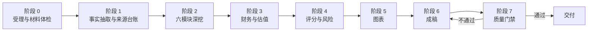

# VC-PreDD

**VC 360 度投研尽调报告生成器。把一份 BP 变成投决会可以直接使用的尽调报告：单文件 HTML、十张图表、100 分记分卡，以及一份明确写出「哪些没查到」的缺口台账。**

[](#许可证)
[](#效果预览)
[](#报告包含什么)
[](#质量门禁)
[](README.md)

[English](README.md) | **简体中文**


---

## 为什么做这个

AI 写的投资报告，翻车方式高度一致：数字没有出处，风险只描述不量化和不给解法，以及每个项目看起来都值得投，因为评分尺度是当场拍出来的。

这个技能是对上述三件事的正面回应。它更像一套可执行的工作流，并不属于那种复制粘贴一次的提示词：固定的评分锚点、来源台账、两道自动化质量门禁，以及一份已经跑过真实浏览器和 PDF 渲染的模板。

默认面向早期财务性 VC（天使轮至 A+ 轮），口径按硬科技、AI、机器人、半导体、企业服务调好，其他行业按参考文件里的适配段切换。

---

## 报告包含什么

十七个章节，排序依据是投决会真实的阅读顺序：

| 序 | 章节 | 交付内容 |
|---|---|---|
| 封面 | 交易识别 | 标的、轮次、投前估值、基准日、密级 |
| 1 | 执行摘要 | 500 字以内，只放判断与逻辑，不放财务明细 |
| 2 | 投决记分卡 | 总分、六维得分、评级、结论 |
| 3 | 交易标的概况 | 基础信息、股权结构、核心财务、发展历程 |
| 4 | 市场与产业链 | TAM/SAM/SOM 三法交叉、驱动因素、产业链卡位、竞争矩阵 |
| 5 | 技术与产品 | 技术路线对比、专利墙、实验室到量产里程碑 |
| 6 | 商业模式 | 单位经济模型、客户结构健康度、渠道有效性 |
| 7 | 财务诊断 | 五组勾稽校验、收入质量、资金消耗率、敏感性 |
| 8 | 团队与组织 | 履历交叉验证、股权健康度、组织效率 |
| 9 | 差异化优势 | 三条差异化主张，每条都要有可验证证据 |
| 10 | 风险雷达与登记表 | 雷达图加高/中/低三级风险，每条带解决路径 |
| 11 | 空头论点 | 反方最强的三条论证，以及证伪它们需要什么证据 |
| 12 | 估值与交易结构 | 多法估值区间、条款设计、退出路径测算 |
| 13 | 投后监控 | 财务、业务、技术、市场、估值五类指标与阈值 |
| 14 | 尽调问题清单 | 按访谈对象分组，每题带目的与红旗信号 |
| 15 | 信息缺口 | 编号台账，含影响度与获取方式 |
| 16 | 需人工复核事项 | 升级卡片，这类判断不该由模型一锤定音 |
| 17 | 免责声明与落款 | 固定文案 |

---

## 效果预览

截图使用虚构的演示项目（星轨智能，仿生力控灵巧手），仅用于展示版式。本仓库不含任何真实项目数据。

| 投决记分卡 | 竞争矩阵 |
|---|---|
|  |  |

| 收入、毛利率与经营现金流 | 风险雷达 |
|---|---|
|  |  |

| 估值倍数对比 | 带解决路径的风险卡片 |
|---|---|
|  |  |

---

## 工作流程



两个设计决定比其他所有细节都重要。

**阶段 0 是硬闸门。** 材料撑不起一份报告时，技能会停下来，改出一份《材料需求清单》，不硬写。财务数据缺失还能写出的报告，比没有报告更危险。

**阶段 7 靠脚本执行，不靠自觉。** 长文本生成过程中的自我约束并不可靠。`check_report.py` 机械校验每处论断是否挂了来源编号、股比是否合计 100.00%、图表容器与初始化调用是否一一对应、有没有混入「有望大幅」这类无信息量措辞。

---

## 安装

技能遵循 `SKILL.md` 目录约定，克隆到你的技能目录即可：

```bash
git clone https://github.com/one5ds/VC-PreDD.git \
  ~/.workbuddy/skills/vc-dd-360-report
```

Windows（PowerShell）：

```powershell
git clone https://github.com/one5ds/VC-PreDD.git `
  "$env:USERPROFILE\.workbuddy\skills\vc-dd-360-report"
```

也可以下载 release 压缩包，解压到技能目录，确保 `SKILL.md` 直接位于技能文件夹内。

克隆的目标目录是 `vc-dd-360-report`，这是 frontmatter 里的技能标识名，须保持小写连字符格式。仓库名 `VC-PreDD` 是对外的展示名，平台索引认的是标识名。

如果你的运行环境从别的目录加载 `SKILL.md` 技能，把文件夹放过去即可。frontmatter 里同时提供了 `name`、`description`、`display_name`、`display_name_en`、`description_zh`，中英文平台都能正常索引。

**环境要求**：自检脚本需要 Python 3.9 以上。渲染检查与 PDF 导出需要 Node.js 18 以上并安装 `puppeteer-core`，浏览器驱动可复用本机已装的 Chrome 或 Edge。

---

## 使用

把材料附上，用自然语言提要求即可，技能按语义触发，不需要特定命令：

```
这是 BP 和 2025 年财务数据，出一份 360 度尽调报告，投决会用
```

```
帮我把这三份材料做成投决会用尽调报告，我们投 A 轮，单笔 3000 万
```

动笔之前它会先确认六项策略参数：阶段、单笔金额、目标持股、赛道范围、风险偏好、回报要求。你没给就用文档里的缺省值，并在封面标注为策略假设。

产出是单个 `.html` 文件，除 ECharts CDN 外无外部依赖。浏览器直接打开，或打印为 A4，分页已经调好。

---

## 评分模型

评分只有在同一把尺子下才有意义。六个固定维度，合计 100 分：

| 维度 | 权重 | 满分锚点 |
|---|---|---|
| 赛道与市场 | 20 | TAM 超过 500 亿元、CAGR 超过 20%、政策明确鼓励、渗透率处于 5%-25% 加速区间 |
| 技术壁垒 | 20 | 核心指标领先现有方案 30% 以上、专利可自由实施、工程化已验证、两年内无成熟替代 |
| 商业模式与单位经济 | 15 | LTV/CAC 不低于 3、毛利率不低于 50%、现金周期短于 90 天、复购可验证 |
| 财务质量 | 15 | 收入与现金流匹配、无异常应收、勾稽自洽、可支撑运营 18 个月以上 |
| 团队与组织 | 15 | 创始人履历可核、控制权稳定、关键人风险已缓释、销售人效高于同业中位 |
| 估值与交易结构 | 15 | 入价低于可比中位、下行有保护、无惩罚性对赌 |

评级档位：**S** 85 分以上、**A** 70 至 84 分、**B** 55 至 69 分、**C** 55 分以下。结论跟随评分，评分不迁就结论。

另有一份一票否决清单。造假迹象、控制权争议未决、核心专利存在诉讼、创始人列入失信名单，任一项触发即强制否决，不再看分数。

---

## 证据纪律

技能对自己强制执行五条，能脚本校验的部分由脚本校验：

1. **无来源不落数。** 每个数字挂 `[S3]` 这类编号，文末台账映射到文件名加页码，或 URL 加发布机构加抓取日期。推断值标 `≈` 并写出公式。
2. **区分四类事实。** 一手文件、公开数据库、企业自述、分析推断。BP 里的市场规模与性能参数默认按待验证处理，不得直接进结论句。
3. **每条风险必须给解法。** 风险描述、量化影响、触发概率、解决路径、残余风险。只描述不给路径，视为这一段没写完。
4. **结论必须可反驳。** 每个评分维度写清扣分依据，执行摘要写明「什么条件下这个判断会被推翻」。
5. **缺口写下来，不许抹平。** 拿不到的数据进编号缺口台账，标注影响度，不用貌似合理的猜测填充。

---

## 质量门禁

技能自带两个脚本。

```bash
# 文本层审计：孤儿来源编号、股比合计、禁用措辞、字数分布、图表容器配对
python scripts/check_report.py report.html

# 骨架阶段：未填的 {{占位符}} 视为待填，不判阻断
python scripts/check_report.py report.html --template

# 渲染审计与 PDF 导出：画布是否真的出图、有无页面错误、表格溢出、页数、页面尺寸
NODE_PATH=<node_modules> node scripts/render_check.js report.html report.pdf
```

`render_check.js` 自动探测浏览器，优先 `chrome-headless-shell`，其次 `chrome`，最后系统 Edge；设 `REPORT_BROWSER` 可覆盖。

模板本身能通过这两道门禁。当前状态：17 章、21 张表 21 个表题、10 张图全部出图、无脚本错误、A4 共 18 页。

---

## 定制

值得改的只有三处，其余建议保持原样。

**评分权重。** 改 `references/04-scoring-and-risk.md` 的权重表。如果你更看重技术领先性，可以把技术壁垒提到 25 分、估值条款降到 10 分，总分仍需保持 100。

**品牌主体。** 落款与免责声明中写的是 `AIOpenVC 投研中心`。换成你自己的主体，需要改 `assets/report-template.html` 两处，以及 `SKILL.md` 第 17 章。

**配色。** 三个主色定义在 `references/05-charts-and-layout.md` 和模板的 CSS 变量里。注意不要动字号和间距，A4 分页逻辑是按实际渲染调出来的。

不要改图表容器结构。ECharts 必须初始化在内层 `div.chart` 上，不能挂在带内边距的 `.chart-container` 上。挂错了画布会向下溢出、底部图例被裁，而且浏览器预览里看不出来，只有导出 PDF 才暴露。

---

## 局限

写清楚，因为一个自我吹嘘的尽调工具本身就是风险。

- 这是**桌面研究**，不替代由责任主体承担的法律、财务、技术、背景尽调。
- 中国工商数据通过检索获取，未接授权接口。注册信息、股权质押、涉诉记录在签约前须以官方登记文件为准。
- 硬科技的多数性能主张无法只凭文件验证。输出会把它们标为未验证，并转入第 16 章人工复核。
- 估值区间是敏感性区间，回答的是「什么必须成立」，并不代表市场价格发现。
- 报告是一份结构化论证，不构成投资建议。

---

## 目录结构

```
SKILL.md                        主流程：五条铁律、七阶段、章节骨架
references/
  01-intake-and-evidence.md     材料体检、证据分级、来源台账、精度口径
  02-analysis-modules.md        六模块口径：TAM 三法、专利墙、TRL 阶段
  03-finance-valuation-deal.md  勾稽公式、资金消耗率、情景测算、条款
  04-scoring-and-risk.md        星级定义、评分锚点、风险分级、红旗清单
  05-charts-and-layout.md       图表规格、字数配额、排版与 PDF 导出
assets/report-template.html     打印就绪的单文件 HTML 骨架，10 张 ECharts
scripts/check_report.py         文本层审计
scripts/render_check.js         渲染审计与 PDF 导出
scripts/check_frontmatter.py    平台索引字段校验
scripts/check_inline_js.py      抽取内联脚本供语法检查
docs/images/                    README 使用的截图
docs/PUBLISHING.md              仓库文案、话题标签与发布说明（中英双版）
```

---

## 参与贡献

欢迎提 issue 和 PR，尤其欢迎两类：各行业的评分锚点校准，以及新增图表配方。动手前请先看 [CONTRIBUTING.md](CONTRIBUTING.md)，里面写明改动必须通过的两项检查。

版本记录见 [CHANGELOG.md](CHANGELOG.md)。

---

## 许可证

MIT，详见 [LICENSE](LICENSE)。

---

## 免责声明

本仓库提供的是一套报告生成方法，不构成投资建议、法律意见或估值意见。用它生成的任何报告，结论只对报告内写明的输入与假设成立。做投资决定前，请以一手材料核对每一项关键事实，并取得专业复核。

⚠️ 以上内容基于公开信息和用户提供材料整理生成，仅供参考，不构成任何投资建议或个股推荐，亦不构成法律意见或 AIOpenVC 投研中心的承诺。投资有风险，决策需谨慎，请结合一手来源和人工专业复核后再决策。
